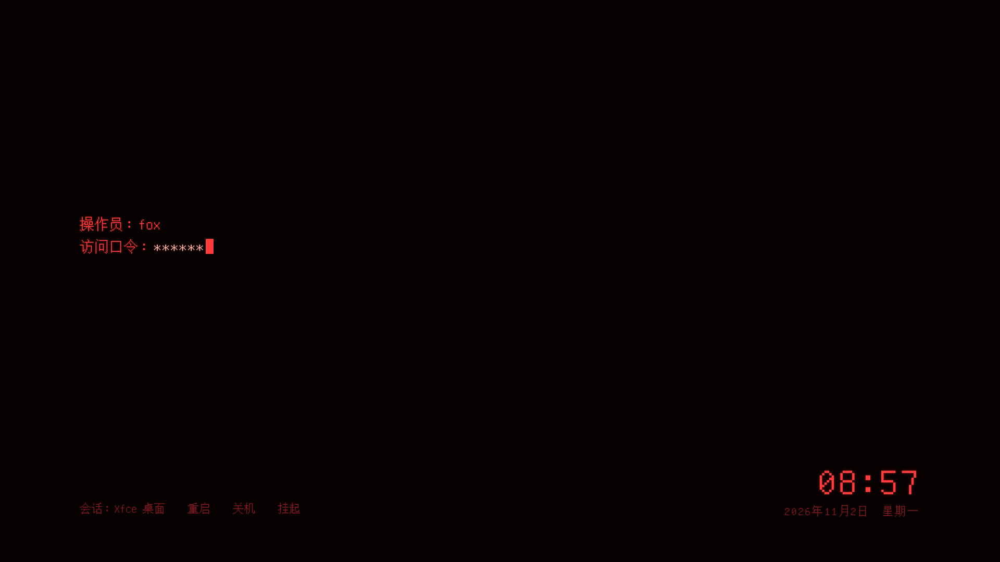

# 朱雀 · Zhuque

A minimal, red, terminal-style login screen for LightDM. All text on it is Simplified
Chinese. Built for Debian 13 (trixie) with Xfce and tested there.



What's on the screen:

- **Left:** the login prompt. It shows `操作员：你的用户名` (user) and `访问口令：` (password)
  with a blinking cursor. A wrong password shows `访问被拒绝` (access denied). The right
  one shows `访问已授权` (access granted) and goes straight to the desktop.
- **Bottom left:** `会话：Xfce 桌面　重启　关机　挂起`. These are Session, Restart,
  Shut down and Sleep.
- **Bottom right:** the time and date.

The only animation is the cursor blink. The prompt is ready as soon as the screen appears.

## Requirements

- Debian 13 (trixie) or another Debian-based system that uses **LightDM**. LightDM is
  the default login manager for Debian's Xfce desktop.
- An internet connection during install. The installer downloads
  [nody-greeter](https://github.com/JezerM/nody-greeter) (~88 MB), the program that
  displays this theme.

Not sure you're on LightDM? This prints `/usr/sbin/lightdm` if you are:

```bash
cat /etc/X11/default-display-manager
```

## Install

**1. Download** the repository into your home folder:

```bash
sudo apt install git
```

```bash
git clone https://github.com/sigenyi/zhuque-greeter.git ~/zhuque-greeter
```

No git? Use **Code → Download ZIP** on this page instead. Unzip it and rename the folder
to `zhuque-greeter` in your home folder.

**2. Run the installer:**

```bash
cd ~/zhuque-greeter
```

```bash
sudo ./install.sh
```

It does the following:

1. checks that LightDM is your display manager
2. installs the fonts (`fonts-unifont`, `fonts-wqy-zenhei`) and the libraries
   nody-greeter needs, including `gir1.2-girepository-2.0`
3. downloads and installs `nody-greeter-1.6.2-debian.deb` from its GitHub releases
4. copies the theme to `/usr/share/web-greeter/themes/zhuque`
5. writes `/etc/lightdm/web-greeter.yml` (the original is backed up to
   `/var/backups/zhuque-greeter/`)
6. adds one file, `/etc/lightdm/lightdm.conf.d/90-zhuque.conf`, that tells LightDM to
   use nody-greeter

**3. Check it before restarting.** Run these as your normal user, without sudo. The first
command should end with `greeter-session=nody-greeter`:

```bash
/usr/sbin/lightdm --show-config 2>&1 | grep greeter-session
```

The second should print a version number such as `1.0.0`:

```bash
nody-greeter --api-version
```

An `ACPI: acpi_listen does not exists` line is harmless. If you see an error mentioning
**Typelib** instead, don't restart; see Troubleshooting.

**4. Restart LightDM.** Save your work first, because this logs you out. Rebooting also
works.

```bash
sudo systemctl restart lightdm
```

## Using it

The mouse works too.

| Key | What it does |
|---|---|
| type, then `Enter` | log in |
| `Esc` | switch user. `其他用户……` (other user) lets you type a user name |
| `Tab` | go to the bottom menu. `←` `→` choose, `Enter` selects, `Esc` goes back |
| `Enter` on `会话` | switch the desktop session |
| `Enter` on `重启` / `关机` / `挂起` | asks `确认…？` first. Press `Enter` to confirm or `Esc` to cancel |

The last user and session you logged in with are remembered.

## Undo

```bash
sudo ~/zhuque-greeter/uninstall.sh
```

```bash
sudo systemctl restart lightdm
```

That brings back Debian's normal login screen. To also remove the theme and nody-greeter,
run `sudo ~/zhuque-greeter/uninstall.sh --purge`.

**If the login screen ever comes up black or broken:** press `Ctrl+Alt+F3`, log in on the
text console, and run:

```bash
sudo ~/zhuque-greeter/uninstall.sh && sudo systemctl restart lightdm
```

## Customise

Edit the files in `theme/zhuque/`, then run `sudo ./install.sh` again to copy them over.

- **Text:** the `T` block at the top of `theme/zhuque/js/zhuque.js`.
- **Colours and sizes:** the `:root` block in `theme/zhuque/css/zhuque.css`.
  - colours: `--red`, `--red-bright`, `--red-dim`
  - text size: `--fs`
  - the prompt's height on screen: `top` under `.term`

To preview a change, open `preview.html` in a browser after running
`python3 dev/build_demo.py`. It's the real theme with a fake LightDM behind it, and the
test password is `zhuque`.

## Troubleshooting

- **`Typelib file for namespace 'GIRepository' … not found`:** run
  `sudo apt install gir1.2-girepository-2.0`.
- **Black screen, and the logs mention the sandbox:** add `--no-sandbox` to the last line
  of `/etc/lightdm/Xgreeter`, so it reads `exec $@ --no-sandbox`.
- **A dialog offers "Use default theme":** nody-greeter shows this when a theme hits an
  error. Click it to get a working login, then check `/var/log/lightdm/seat0-greeter.log`.
- **`ACPI: acpi_listen does not exists`:** harmless. `sudo apt install acpid` silences it.
- **Logs:** `/var/log/lightdm/lightdm.log` and `/var/log/lightdm/seat0-greeter.log`.

## How it works

LightDM is the program behind the login screen. It starts a separate *greeter* to draw
the screen. This project installs nody-greeter, a greeter that draws HTML, CSS and
JavaScript themes, and points LightDM at it with a single config file. Your desktop and
LightDM itself aren't changed. `uninstall.sh` deletes that file and restores the backups.

```
install.sh / uninstall.sh
preview.html                 browser preview (fake LightDM, password: zhuque)
theme/zhuque/
  index.yml                  tells nody-greeter which pages to load
  index.html                 main screen
  secondary.html             other monitors: clock only
  css/zhuque.css
  js/zhuque.js
  fonts/zhuque-pixel.woff2   9 KB subset of GNU Unifont (see fonts/OFL.txt)
dev/                         fake LightDM, preview and font builders, browser tests
```

## Development

```bash
python3 dev/build_demo.py           # rebuild preview.html and dev/preview.html
python3 dev/make_font.py            # rebuild the font subset (needs fonttools, brotli, fonts-unifont)
python3 -m http.server 8765         # then, in another terminal:
node dev/test.js                    # browser tests (needs Playwright)
```

## License

The theme code is under the MIT License (see `LICENSE`). The bundled font subset is
GNU Unifont, under the SIL Open Font License 1.1 (see `theme/zhuque/fonts/OFL.txt`).
nody-greeter is a separate project, downloaded from its own releases during install.
